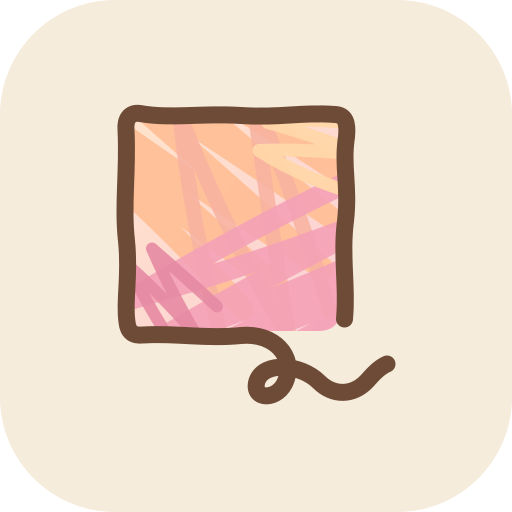
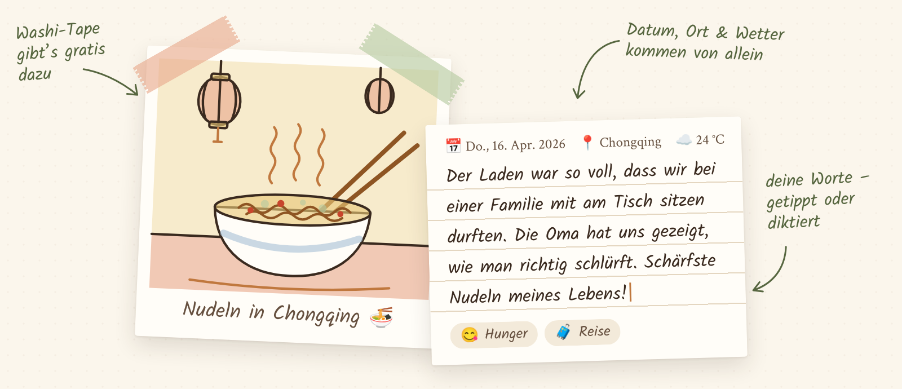

<p align="center">
  
</p>

<h1 align="center">Randnotiz</h1>

<p align="center">
  <em>A private photo diary for Android – for the stories in the margins of your pictures.</em>
</p>

<p align="center">
  <a href="https://github.com/tjorvez/randnotiz/actions/workflows/ci.yml"></a>
  <a href="LICENSE"></a>
  
  
  
</p>

---

## Why Randnotiz?

<picture>
  <source media="(prefers-color-scheme: dark)" srcset="docs/images/notiz-dark.png">
  
</picture>

There are thousands of photos on my phone – but most of them only tell half the story.
Who was there? What did we laugh about? How did the day feel? That's exactly what you
forget first.

Randnotiz is my answer to that: a memory book that should feel like an old photo album
with handwritten notes in the margin ("Randnotiz" is German for *marginal note*). You
pick a photo, write or dictate a few lines about it, and years later the app brings
that very moment back to you.

One thing mattered most to me: **a diary is private.** Randnotiz has no server of its
own, no account, no ads and no tracking. Your entries stay on your device. The optional
backup to Google Drive is end-to-end encrypted; Google only ever sees unreadable data.

Randnotiz is a hobby project, born out of my own need and built with a lot of attention
to detail. It is free software: you may use it, study it, change it and share it.

## Features

| | |
|---|---|
| 📷 **New entry** | Tapping the photo with the plus opens Android's photo picker – photos from your phone or from Google Photos. Randnotiz needs no access to your gallery for this. |
| ✍️ **Note** | Handwriting on lined paper, saved automatically. Header with date · place · weather · moods. Dictation via microphone (in the app's language). |
| 📖 **Journal** | Entries as notebook pages with titles. Full-text search across text, title, moods, place and country, with suggestions and filters. |
| 🌍 **Places & countries** | Set via place search in the entry, with the country added offline. A world map colours in the countries you've been to. |
| ✨ **Memories** | A full-screen slider: first "one year ago today", then the days around it, then everything else at random. |
| 🗂️ **Collections** | Group entries – a trip, a summer, a person. Reorder by dragging. |
| 🎵 **Songs** *(optional)* | A vinyl record on the corner of the Polaroid, with the album cover as its label. Search for a song via Apple Music (no account needed), play a 30-second preview, open it in Apple Music or in another service via song.link. |
| ☁️ **Backup** *(optional)* | End-to-end encrypted in the hidden app folder of your Google Drive, with a backup password and an emergency key. |
| 🔒 **Lock** | Fingerprint/face. With the lock enabled, release builds allow no screenshots and show no preview in the recent-apps overview. |
| 🏠 **Widget** | "Memory of the day" on your home screen. |

Plus: light and dark mode, subtle seasonal accents, **English, German, French and
Spanish** (English by default; selectable in the intro, in the settings and, from
Android 13 on, in Android's per-app language setting) and an intro on first launch: a
welcome with language selection, the optional encrypted backup and a short animated
tour of the app – under the motto *"Write your own story – instead of just swiping
through other people's."*

## Privacy at a glance

- Notes, moods and places live **only in the app's private storage** – in an
  **encrypted database** whose key is kept in the Android Keystore and never leaves the
  device. Android's own cloud backup is deliberately disabled.
- Only what a feature actually needs goes online: weather and place search (Open-Meteo,
  without any identifier), possibly Google's speech recognition, the song search at
  Apple (only when you add a song, no account) and – only if you turn it on – the
  encrypted Drive backup.
- Randnotiz **only sees the photos you pick** – no access to your gallery. It stores
  place and country names, not coordinates.

All the details: the [privacy policy](https://randnotiz.info/en/privacy/) on
randnotiz.info ([German original](https://randnotiz.info/de/datenschutz/)).

## Backup to Google Drive

A diary that lives on a single phone is vulnerable: one drop, a theft or a new phone –
and years of memories are gone. That's why Randnotiz can back up your diary to your own
Google Drive, without anyone but you being able to read it.

**What you get**

- **New phone, same diary:** sign in, enter your backup password, restore – notes,
  moods, collections and photos are back.
- **Runs on its own:** once a day, only when something has changed. Any time on top of
  that via "Back up now".
- **Your storage, not someone else's server:** the backup lives in the hidden app folder
  of your Google Drive. Randnotiz can't see your other Drive files, and the backup
  doesn't show up among them.
- **Economical:** photos are backed up as downscaled copies, and nothing unchanged is
  ever uploaded twice.

**How it's protected**

Everything is **encrypted on your device before it is uploaded** (AES-256-GCM, each
object separately). The key is derived from your **backup password** (Argon2id); in
addition you get an **emergency key** to write down in case you ever forget the password.
Google only stores unreadable data – even file names give nothing away, and known
images can't be recognised.

> [!NOTE]
> This also means: if both the backup password **and** the emergency key are lost,
> nobody can open the backup – not Google, not me, not you. So keep the emergency key
> somewhere safe.

The backup is optional. Randnotiz works fully without it, with no sign-in at all.

## Installation

Randnotiz is coming to the **Google Play Store** – the link will appear here once the
app has been approved. Updates will then arrive automatically through Play.

**Switching from the APK version?** The Play version has its own app ID
(`randnotiz.app`; the APK version is `io.github.randnotiz.app`), so both can be
installed side by side – you can tell the Play version by its new hand-drawn logo,
whose colours change with the seasons. To bring your diary along:

1. In the old app, go to Settings → Backup, tap **"Back up now"** and make sure your
   backup password or emergency key is at hand.
2. Install Randnotiz from the Play Store, connect the same Google account and
   **unlock and restore** the backup.
3. Once everything is there, uninstall the old app. Both apps back up to the same Drive
   folder – as long as both are installed, only keep writing in one of them.

The Play version no longer reads the gallery. Photos of entries that the old app took
straight from the gallery are restored from the backed-up copy (about 800 px); photos
from Google Photos come back as before at up to 1600 px.

> [!IMPORTANT]
> **Uninstalling deletes all notes.** Because Randnotiz deliberately opts out of
> Android's cloud backup, its own backup is the only way to take a diary to a new
> device. Set it up under Settings → Backup and tap "Back up now" before switching
> phones. Without the backup password and emergency key nobody can open the backup –
> not even you.

With the lock enabled, screenshots inside the app are blocked. That's intentional.

## Building it yourself

**Requirements:** Flutter 3.47 (stable channel, Dart 3.13), Android SDK, JDK 17 for Gradle
(`flutter config --jdk-dir …`).

```bash
flutter pub get
flutter analyze
flutter test

flutter run                            # debug build on the connected phone
flutter build apk --release            # release APK (signing: see below)
adb install -r build/app/outputs/flutter-apk/app-release.apk
flutter build appbundle                # bundle for the Play Store
```

> [!WARNING]
> `flutter install` uninstalls first – and with it deletes all notes. To update, always
> use `adb install -r …`, and never run `adb uninstall` with the real app ID
> `randnotiz.app`.

### Setting up the Google Drive backup

Without any configuration of your own the app builds and runs normally; the backup is
then greyed out ("Not available in this version"). For your own build with backup:

1. Create a project in the [Google Cloud Console](https://console.cloud.google.com/)
   and enable the **Google Drive API** ("APIs & Services" → "Library").
2. Configure the **OAuth consent screen**: type "External", app name, support email and
   the scope `https://www.googleapis.com/auth/drive.appdata` (the hidden app folder
   only). In testing mode, add yourself as a test user.
3. Create **OAuth client IDs of type Android** – one for each combination of package
   name and signing-key SHA-1 you use:
   - `randnotiz.app` (the real app) and, if needed, `randnotiz.app.dev` (the test app)
   - each with the SHA-1 of the debug key (see below) and/or the upload key (see
     [Signing](#signing)); for the Play Store, additionally the app signing key from
     the Play Console ("App integrity")

   The app itself doesn't need these IDs – Google matches them via package name + SHA-1.
4. Create a **web client ID** (type "Web application", without redirect URIs). It is
   used as `serverClientId` for `google_sign_in`.
5. Copy `google.example.json` to `google.local.json` and enter the **web client ID**;
   Gradle bakes it in as `BuildConfig.GOOGLE_WEB_CLIENT_ID`. The file is listed in
   `.gitignore` and is never committed.

SHA-1 of the debug key (default path; adjust it if you use a different
`ANDROID_USER_HOME`):

```bash
keytool -list -v -keystore ~/.android/debug.keystore \
  -alias androiddebugkey -storepass android | grep SHA1
```

### Signing

Release builds are signed with the **upload key** from `android/key.properties`.
Without this file, `flutter build apk --release` signs with your machine's debug key –
good enough for personal use.

1. Generate the key once and store it **outside the repository**:

   ```bash
   keytool -genkeypair -v -keystore ~/keys/randnotiz-upload.jks \
     -keyalg RSA -keysize 4096 -validity 10000 -alias upload
   ```
2. Create `android/key.properties`:

   ```properties
   storePassword=…
   keyPassword=…
   keyAlias=upload
   storeFile=/path/to/your/randnotiz-upload.jks
   ```

   This file and keystores (`*.jks`, `*.keystore`) are listed in `.gitignore`.
3. **Back up** the keystore and passwords **twice** (e.g. password manager + offline
   copy). Updates to an app distributed as an APK only work with the same key – if it's
   lost, everyone would have to uninstall the app and, without a backup, would lose
   their notes.
4. SHA-1 of the upload key for the Cloud Console:

   ```bash
   keytool -list -v -keystore /path/to/your/randnotiz-upload.jks -alias upload | grep SHA1
   ```

For updates via APK, sign every release with exactly this key. For the Play Store,
**Play App Signing** is recommended: Google then manages the actual app signing key,
and the upload key can be reset if it's lost.

### Developing without touching your real diary

If you use Randnotiz every day yourself, you don't want to risk your own entries while
trying things out. For that there's a separate **test app "Randnotiz Dev"**
(`randnotiz.app.dev`) with its own database:

```bash
# Debug variant (only affects debug and profile builds)
flutter build apk --debug -P randnotizDev=true
adb install -r build/app/outputs/flutter-apk/app-debug.apk

# Skip the lock at runtime (debug only; the setting itself stays unchanged)
flutter run --dart-define=RANDNOTIZ_DEBUG_NO_LOCK=true
```

<details>
<summary>Test app as a release build (upload key, Drive restore)</summary>

To check the upload key, the SHA-1 in the Cloud Console and restoring with a real
release APK. Behaves like the real release (FLAG_SECURE, no debug switches):

```bash
# needs android/key.properties – otherwise the build fails; it never silently signs
# with the debug key. APK only, no app bundle
flutter build apk --release -P randnotizDevRelease=true

# If the test app was previously installed as a debug build, Android rejects the
# different signature. In that case remove ONLY the test app first (deletes its data):
adb uninstall randnotiz.app.dev
adb install -r build/app/outputs/flutter-apk/app-release.apk
```

- For the Drive backup, this variant needs its **own Android OAuth client ID** for
  `randnotiz.app.dev` with the **SHA-1 of the upload key** in the Google Cloud Console.
- **Careful, shared Drive folder:** the test app and the real app see the same backup
  (the hidden app folder belongs to the Cloud project, not to the package name). The
  test app points this out on the backup screen and asks again before "Set backup
  password", "Unlock" and "Delete backup". Test with a separate Google account, or
  finish with "Sign out" + "Also delete the backup in Google Drive" – otherwise the
  real app will find a backup full of test data.

</details>

### Generated code

Drift and localisation output are checked in, so a build doesn't need `build_runner`.
After changing tables or ARB files:

```bash
dart run build_runner build          # Drift
dart run drift_dev make-migrations   # after bumping schemaVersion
flutter gen-l10n                     # strings from lib/l10n/*.arb (template: app_en.arb)
```

Regenerating the geodata (source data is not checked in; links in the script headers):

```bash
python3 -I tools/build_geodata.py <folder-with-source-data> assets/geo
python3 -I tools/build_world_map.py <folder>/ne_50m_land.geojson assets/map/land.bin
```

Regenerating the launcher icons, the start-screen logo and the store icon from
`assets/branding/icon_*.svg` (needs `rsvg-convert` from librsvg):

```bash
python3 tools/build_icons.py
```

## Under the hood

Flutter with Riverpod and go_router, SQLite via Drift with FTS5 full-text search,
organised feature-first. All external services sit behind interfaces; the tests run
against fakes and an in-memory database – including every schema upgrade path. The
world map is a custom `CustomPainter` without map tiles, and places and countries are
resolved entirely offline.

<details>
<summary>Project structure</summary>

```
lib/
  main.dart                  Startup, dependencies (DB, prefs, storage locations)
  app/                       App, router (go_router), navigation (floating pill, sliding
                             tabs), providers
  core/
    database/                Drift schema, migrations (v1–v11), FTS5 index, encryption
    debug/                   Slow motion (debug), frame statistics (profile)
    search/                  FTS queries, umlaut/ß variants, highlighting
    theme/                   Light/dark colours, seasons, typography
    widgets/                 Paper, Polaroid, washi tape, logo, shared building blocks
    platform/                FLAG_SECURE channel, app version, test-app detection
  features/                  Feature-first, each with domain/ data/ presentation/
    library/                 Photo picker, private photo copies, "New entry"
    notes/                   Notes, editor, place panel, thumbnails
    tags/                    Moods (emoji + name)
    journal/  memories/      Journal with search/suggestions, memories slider
    geo/                     Offline countries/places, matching, country picker
    map/                     World map (CustomPainter, no tiles)
    collections/             Collections
    dictation/               Dictation (speech_to_text), insertion logic
    weather/                 WeatherProvider + PlaceSearch (Open-Meteo)
    lock/  settings/         Biometric lock, settings
    intro/                   Intro on first launch
    memory_widget/           Data for the home-screen widget
    backup/                  Encrypted Drive backup: crypto/ (keyring, AES-GCM,
                             emergency key), remote/ (Drive REST), writer/restorer,
                             snapshot format
  l10n/                      app_en/de/fr/es.arb (+ generated)
android/app/src/main/kotlin/ MainActivity (FLAG_SECURE, microphone permission, photo picker),
                             ImageTools, LauncherIcon + Season (seasonal launcher icon),
                             widget/MemoryWidgetProvider
test/                        Database, migrations, search, memories, dictation, lock, …
drift_schemas/               Schema dumps per version (for migration tests)
assets/                      Fonts (OFL), logo, land masses, geodata (assets/geo)
tools/                       Scripts for map and geodata (Natural Earth, GeoNames) and
                             for the app icons
docs/                        README illustration, Play Store texts and graphics
.github/                     CI (format, analyze, test), issue templates
```

</details>

## Further documents

| Document | Contents |
|---|---|
| [PRIVACY.md](PRIVACY.md) | Where to find the privacy policy (randnotiz.info), with a short summary |
| [NOTICE.md](NOTICE.md) | Attributions for map data, place names, fonts and the Apple Music badge |
| [SECURITY.md](SECURITY.md) | How to report a security vulnerability privately |
| [CONTRIBUTING.md](CONTRIBUTING.md) | Bug reports, ideas and pull requests |
| [LICENSE](LICENSE) | GNU General Public License v3.0 |

## Feedback

Randnotiz is a one-person project that I maintain in my spare time. I'm happy about bug
reports, ideas and experiences – ideally as an
[issue](https://github.com/tjorvez/randnotiz/issues). Please **don't attach
screenshots with private photos or real diary entries**. Security problems please
report privately (see [SECURITY.md](SECURITY.md)); for pull requests see
[CONTRIBUTING.md](CONTRIBUTING.md).

## License and thanks

Copyright © 2026 Even Tjorve Zankl.

Randnotiz is free software under the **GNU General Public License v3.0 or later**
([LICENSE](LICENSE)). It comes without any warranty.

Thanks to everyone whose work went into this app: [Natural Earth](https://www.naturalearthdata.com)
for the map data, [GeoNames](https://www.geonames.org) for the place names,
[Open-Meteo](https://open-meteo.com) for weather and place search, the Indian Type
Foundry and the Crimson Text project for the fonts *Kalam* and *Crimson Text* – and the
Flutter community for a wonderful ecosystem. Licenses and attributions in detail:
[NOTICE.md](NOTICE.md).

<p align="center"><sub>Made with care – for memories that are meant to last.</sub></p>
