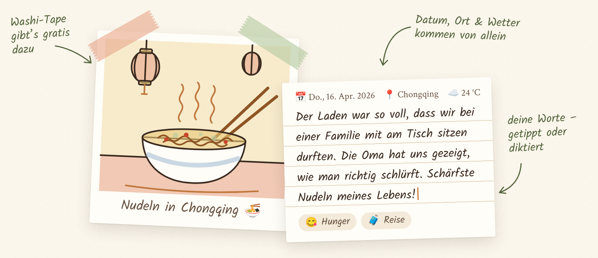

<p align="center">
  
</p>

<h1 align="center">Randnotiz</h1>

<p align="center">
  <em>Ein privates Foto-Tagebuch für Android – für die Geschichten am Rand deiner Bilder.</em>
</p>

<p align="center">
  <a href="LICENSE"></a>
  
  
  
</p>

---

## Warum Randnotiz?

<picture>
  <source media="(prefers-color-scheme: dark)" srcset="docs/images/notiz-dark.png">
  
</picture>

Auf meinem Handy liegen tausende Fotos – aber die meisten erzählen nur die halbe
Geschichte. Wer war dabei? Worüber haben wir gelacht? Wie hat sich der Tag angefühlt?
Genau das vergisst man zuerst.

Randnotiz ist meine Antwort darauf: ein Erinnerungsbuch, das sich anfühlen soll wie ein
altes Fotoalbum mit handschriftlichen Notizen am Rand. Du wählst ein Foto, schreibst
oder diktierst ein paar Zeilen dazu, und Jahre später spielt dir die App genau diesen
Moment wieder zu.

Dabei war mir eines besonders wichtig: **Ein Tagebuch ist privat.** Randnotiz hat
keinen eigenen Server, kein Konto, keine Werbung und kein Tracking. Deine Einträge
bleiben auf deinem Gerät. Die optionale Sicherung in Google Drive ist
Ende-zu-Ende-verschlüsselt, Google sieht davon nur unlesbare Daten.

Randnotiz ist ein Hobbyprojekt, entstanden aus eigenem Bedarf und mit viel Liebe zum
Detail. Es ist freie Software: Du darfst es nutzen, verstehen, verändern und
weitergeben.

## Funktionen

| | |
|---|---|
| 📷 **Neuer Eintrag** | Das Foto-Plus in der Navigation öffnet die Fotoauswahl des Systems (inklusive Google Fotos); das Foto wird als private Kopie übernommen. |
| ✍️ **Notiz** | Handschrift auf liniertem Papier, speichert automatisch. Kopfzeile mit Datum · Ort · Wetter · Stimmungen. Diktat per Mikrofon (Deutsch). |
| 📖 **Tagebuch** | Einträge als Heftseiten mit Titel. Volltextsuche über Text, Titel, Stimmungen, Ort und Land, mit Vorschlägen und Filtern. |
| 🌍 **Orte & Länder** | Offline aus dem Fotostandort bestimmt, von Hand änderbar. Eine Weltkarte färbt die Länder ein, in denen du warst. |
| ✨ **Erinnerungen** | Ein Vollbild-Slider: zuerst „heute vor einem Jahr“, dann die Tage drumherum, dann alles andere zufällig. |
| 🗂️ **Sammlungen** | Einträge bündeln – eine Reise, ein Sommer, ein Mensch. Per Ziehen sortierbar. |
| 🎵 **Lieder** *(optional)* | Eine Schallplatte auf der Ecke des Polaroids, das Albumcover als Etikett. Lied über Spotify suchen und abspielen. |
| ☁️ **Sicherung** *(optional)* | Ende-zu-Ende-verschlüsselt im versteckten App-Ordner deines Google Drive, mit Backup-Passwort und Notfallschlüssel. |
| 🔒 **Sperre** | Fingerabdruck/Gesicht. Bei aktiver Sperre im Release-Build kein Screenshot und keine Vorschau in der App-Übersicht. |
| 🏠 **Widget** | „Erinnerung des Tages“ auf dem Startbildschirm. |

Dazu: Hell- und Dunkelmodus, dezente Jahreszeiten-Akzente und eine kurze Einführung beim
ersten Start, die Privatsphäre, Sperre und Sicherung erklärt.

## Privatsphäre auf einen Blick

- Notizen, Stimmungen und Orte liegen **nur im privaten Speicher der App**. Androids
  eigenes Cloud-Backup ist bewusst abgeschaltet.
- Ins Netz geht nur, was eine Funktion wirklich braucht: Wetter und Ortssuche
  (Open-Meteo, ohne Kennung), ggf. Googles Spracherkennung, und – nur wenn du sie
  einschaltest – Spotify und die verschlüsselte Drive-Sicherung.
- Vom Fotostandort werden **keine Koordinaten gespeichert**, nur Orts- und Ländernamen.

Alle Details: [PRIVACY.md](PRIVACY.md).

## Sicherung in Google Drive

Ein Tagebuch, das nur auf einem einzigen Handy liegt, ist verletzlich: Ein Sturz, ein
Diebstahl oder ein Gerätewechsel – und Jahre an Erinnerungen sind weg. Deshalb kann
Randnotiz dein Tagebuch in deinem eigenen Google Drive sichern, ohne dass dafür jemand
außer dir es lesen kann.

**Was du davon hast**

- **Neues Handy, gleiches Tagebuch:** Anmelden, Backup-Passwort eingeben,
  wiederherstellen – Notizen, Stimmungen, Sammlungen und Fotos sind wieder da.
- **Läuft von allein:** einmal am Tag, nur wenn sich etwas geändert hat. Jederzeit
  zusätzlich per „Jetzt sichern“.
- **Dein Speicher, kein fremder Server:** Die Sicherung liegt im versteckten App-Ordner
  deines Google Drive. Randnotiz sieht deine übrigen Drive-Dateien nicht, und die
  Sicherung taucht dort nicht zwischen deinen Dateien auf.
- **Sparsam:** Fotos werden als verkleinerte Kopien gesichert, Unverändertes wird nie
  zweimal hochgeladen.

**Wie sie geschützt ist**

Alles wird **auf deinem Gerät verschlüsselt, bevor es hochgeladen wird** (AES-256-GCM,
jedes Objekt einzeln). Der Schlüssel dazu entsteht aus deinem **Backup-Passwort**
(Argon2id); zusätzlich bekommst du einen **Notfallschlüssel** zum Aufschreiben, falls
du das Passwort einmal vergisst. Google speichert nur unlesbare Daten – selbst
Dateinamen verraten nichts, und bekannte Bilder lassen sich nicht wiedererkennen.

> [!NOTE]
> Das bedeutet auch: Gehen Backup-Passwort **und** Notfallschlüssel verloren, kann
> niemand die Sicherung öffnen – weder Google noch ich noch du. Bewahre den
> Notfallschlüssel deshalb an einem sicheren Ort auf.

Die Sicherung ist freiwillig. Ohne sie funktioniert Randnotiz vollständig, ganz ohne
Anmeldung.

## Installieren

Fertige APKs gibt es unter [**Releases**](https://github.com/tjorvez/randnotiz/releases).

1. **Datei wählen:** Für fast alle aktuellen Handys `app-arm64-v8a-release.apk`, für
   ältere 32-Bit-Geräte `app-armeabi-v7a-release.apk`.
2. **Prüfsumme vergleichen** (empfohlen): Die SHA-256-Werte stehen beim Release in
   `SHA256SUMS.txt`.

   ```bash
   sha256sum app-arm64-v8a-release.apk   # muss mit dem Wert beim Release übereinstimmen
   ```

   Weicht der Wert ab, die Datei bitte nicht installieren.
3. **Installieren:** Die APK auf dem Handy öffnen. Android fragt einmalig, ob Browser
   bzw. Dateimanager **unbekannte Apps installieren** dürfen – erlauben (danach kann man
   es wieder ausschalten). Play Protect warnt eventuell vor einem unbekannten
   Entwickler.
4. **Updates:** Die neuere APK einfach drüberinstallieren, die Notizen bleiben erhalten.
   Lehnt Android die Installation ab, bitte **nicht deinstallieren**, sondern zuerst
   sichern (siehe unten).

> [!IMPORTANT]
> **Deinstallieren löscht alle Notizen.** Weil Randnotiz Androids Cloud-Backup bewusst
> ausschließt, ist die eigene Sicherung der einzige Weg, ein Tagebuch auf ein neues
> Gerät mitzunehmen. Richte sie unter Einstellungen → Sicherung ein und tippe vor einem
> Gerätewechsel auf „Jetzt sichern“. Ohne Backup-Passwort und Notfallschlüssel kann
> niemand die Sicherung öffnen – auch du nicht.

Bei eingeschalteter Sperre sind in der App keine Screenshots möglich. Das ist Absicht.

## Selbst bauen

**Voraussetzungen:** Flutter (stable), Android SDK, JDK 17 für Gradle
(`flutter config --jdk-dir …`).

```bash
flutter pub get
flutter analyze
flutter test

flutter run                            # Debug auf dem angeschlossenen Handy
flutter build apk --release            # Release-APK (Signatur: siehe unten)
adb install -r build/app/outputs/flutter-apk/app-release.apk
flutter build appbundle                # Bundle für den Play Store
```

> [!WARNING]
> `flutter install` deinstalliert vorher – und löscht damit alle Notizen. Zum
> Aktualisieren immer `adb install -r …` verwenden und `adb uninstall` nie mit der
> echten App-ID `io.github.randnotiz.app` ausführen.

### Optionale Funktionen

Ohne eigene Konfiguration baut und läuft die App ganz normal, nur diese beiden
Funktionen fehlen dann:

| Funktion | Ohne Konfiguration | Einrichtung |
|---|---|---|
| Lieder (Spotify) | keine Schallplatte | [Spotify](#spotify), `spotify.local.json` |
| Sicherung in Google Drive | ausgegraut („In dieser Version nicht verfügbar“) | [Google Drive](#google-drive), `google.local.json` |

Beide `*.local.json`-Dateien stehen in `.gitignore` und werden nie committet.

#### Spotify

1. Im [Spotify Developer Dashboard](https://developer.spotify.com/dashboard) eine App
   anlegen (APIs: **Android** und **Web API**). Im Entwicklungsmodus braucht der
   Besitzer Spotify Premium; bis zu fünf Testnutzer.
2. Dort eintragen:
   - **Redirect URI**, z. B. `randnotiz://spotify-callback`
   - **Android-Pakete** `io.github.randnotiz.app` und (für die Test-App)
     `io.github.randnotiz.app.dev`, jeweils mit dem SHA-1-Fingerabdruck deines
     Signaturschlüssels. Für den Debug-Schlüssel:

     ```bash
     keytool -list -v -keystore ~/.android/debug.keystore \
       -alias androiddebugkey -storepass android | grep SHA1
     ```

     (Standardpfad; liegt der Schlüssel bei dir woanders, z. B. über
     `ANDROID_USER_HOME`, diesen Pfad nehmen.) Upload-Schlüssel: siehe
     [Signieren](#signieren).
3. `spotify.example.json` nach `spotify.local.json` kopieren und Client-ID und
   Redirect URI eintragen. Gradle liest die Datei beim Bauen (BuildConfig + Manifest).
4. Zum Abspielen direkt aus Randnotiz das **Spotify App Remote SDK** herunterladen (es
   darf nicht mitverteilt werden):

   ```bash
   curl -sSLo android/app/libs/spotify-app-remote-release-0.8.0.aar \
     https://github.com/spotify/android-sdk/releases/download/v0.8.0-appremote_v2.1.0-auth/spotify-app-remote-release-0.8.0.aar
   ```

   Ohne SDK öffnet ein Tipp auf die Schallplatte das Lied in der Spotify-App.

<details>
<summary>Technische Details zur Spotify-Anbindung</summary>

Suche über die Spotify Web API (`/v1/search`, höchstens 10 Treffer). Anmeldung über die
Spotify Auth Library und die installierte Spotify-App (Token-Flow, kein Client-Secret;
Scopes `user-read-private` für die Suche und `app-remote-control` zum Abspielen). Die
Abspiel-Freigabe holt Randnotiz über diesen Login, nicht über das Freigabe-Fenster des
App Remote SDK: Das müsste Spotify aus dem Hintergrund öffnen, was Android ab Version 10
blockiert – die Verbindung bliebe dann ohne Rückmeldung hängen.

</details>

#### Google Drive

1. In der [Google Cloud Console](https://console.cloud.google.com/) ein Projekt anlegen
   und die **Google Drive API** aktivieren („APIs & Dienste“ → „Bibliothek“).
2. **OAuth-Zustimmungsbildschirm** konfigurieren: Typ „Extern“, App-Name, Support-E-Mail
   und den Scope `https://www.googleapis.com/auth/drive.appdata` (nur der versteckte
   App-Ordner). Im Testmodus dich selbst als Testnutzer eintragen.
3. **OAuth-Client-IDs vom Typ Android** anlegen – je eine pro Kombination aus Paketname
   und SHA-1 des Signaturschlüssels, die du nutzt:
   - `io.github.randnotiz.app` (echte App) und ggf. `io.github.randnotiz.app.dev`
     (Test-App)
   - jeweils mit dem SHA-1 des Debug-Schlüssels (Befehl unter [Spotify](#spotify)) und/oder
     des Upload-Schlüssels (siehe [Signieren](#signieren)); im Play Store zusätzlich der
     App-Signaturschlüssel aus der Play Console („App-Integrität“)

   Die App selbst braucht diese IDs nicht – Google ordnet sie über Paketname + SHA-1 zu.
4. Eine **Web-Client-ID** (Typ „Webanwendung“, ohne Weiterleitungs-URIs) anlegen. Sie
   dient `google_sign_in` als `serverClientId`.
5. `google.example.json` nach `google.local.json` kopieren und die **Web-Client-ID**
   eintragen; Gradle baut sie als `BuildConfig.GOOGLE_WEB_CLIENT_ID` ein.

### Signieren

Release-Builds werden mit dem **Upload-Schlüssel** aus `android/key.properties`
signiert. Ohne diese Datei signiert `flutter build apk --release` mit dem
Debug-Schlüssel des Rechners – das reicht für den Eigengebrauch.

1. Schlüssel einmalig erzeugen und **außerhalb des Repos** ablegen:

   ```bash
   keytool -genkeypair -v -keystore ~/keys/randnotiz-upload.jks \
     -keyalg RSA -keysize 4096 -validity 10000 -alias upload
   ```
2. `android/key.properties` anlegen:

   ```properties
   storePassword=…
   keyPassword=…
   keyAlias=upload
   storeFile=/pfad/zu/deinem/randnotiz-upload.jks
   ```

   Diese Datei und Keystores (`*.jks`, `*.keystore`) stehen in `.gitignore`.
3. Keystore und Passwörter **doppelt sichern** (z. B. Passwortmanager +
   Offline-Kopie). Updates einer per APK verteilten App gehen nur mit demselben
   Schlüssel – ist er weg, müssten alle die App deinstallieren und verlören ohne
   Sicherung ihre Notizen.
4. SHA-1 des Upload-Schlüssels für Cloud Console und Spotify-Dashboard:

   ```bash
   keytool -list -v -keystore /pfad/zu/deinem/randnotiz-upload.jks -alias upload | grep SHA1
   ```

Für Updates per APK alle Releases mit genau diesem Schlüssel signieren. Im Play Store
empfiehlt sich **Play App Signing**: Google verwaltet dann den eigentlichen
App-Signaturschlüssel, und der Upload-Schlüssel lässt sich bei Verlust zurücksetzen.

### Entwickeln, ohne das echte Tagebuch anzufassen

Wer Randnotiz selbst täglich nutzt, will beim Ausprobieren nicht die eigenen Einträge
riskieren. Dafür gibt es eine getrennte **Test-App „Randnotiz Dev“**
(`io.github.randnotiz.app.dev`) mit eigener Datenbank:

```bash
# Debug-Variante (wirkt nur auf Debug- und Profile-Builds)
flutter build apk --debug -P randnotizDev=true
adb install -r build/app/outputs/flutter-apk/app-debug.apk

# Sperre zur Laufzeit überspringen (nur Debug; die Einstellung bleibt unverändert)
flutter run --dart-define=RANDNOTIZ_DEBUG_NO_LOCK=true
```

<details>
<summary>Test-App als Release-Build (Upload-Schlüssel, Drive-Wiederherstellung)</summary>

Um Upload-Schlüssel, SHA-1 in der Cloud Console und die Wiederherstellung mit einer
echten Release-APK zu prüfen. Verhält sich wie der echte Release (FLAG_SECURE, keine
Debug-Schalter):

```bash
# braucht android/key.properties – sonst bricht der Build ab, es wird nie still mit
# dem Debug-Schlüssel signiert; nur APK, kein App Bundle
flutter build apk --release -P randnotizDevRelease=true

# War die Test-App vorher als Debug-Build installiert, lehnt Android die andere
# Signatur ab. Dann zuerst NUR die Test-App entfernen (löscht deren Daten):
adb uninstall io.github.randnotiz.app.dev
adb install -r build/app/outputs/flutter-apk/app-release.apk
```

- Für die Drive-Sicherung (und ggf. Spotify) braucht diese Variante in der Google
  Cloud Console eine **eigene Android-OAuth-Client-ID** für
  `io.github.randnotiz.app.dev` mit dem **SHA-1 des Upload-Schlüssels**; im
  Spotify-Dashboard entsprechend Paketname + SHA-1.
- **Achtung, geteilter Drive-Ordner:** Test-App und echte App sehen dieselbe Sicherung
  (der versteckte App-Ordner gehört zum Cloud-Projekt, nicht zum Paketnamen). Die
  Test-App weist im Sicherungs-Bildschirm darauf hin und fragt vor „Backup-Passwort
  festlegen“, „Entsperren“ und „Sicherung löschen“ noch einmal nach. Tests mit einem
  eigenen Google-Konto machen oder mit „Abmelden“ + „Auch die Sicherung in Google
  Drive löschen“ beenden – sonst findet die echte App eine Sicherung mit Testdaten.

</details>

### Generierter Code

Drift und Lokalisierung sind eingecheckt, ein Build braucht also kein `build_runner`.
Nach Änderungen an Tabellen oder ARB-Dateien:

```bash
dart run build_runner build          # Drift
dart run drift_dev make-migrations   # nach Erhöhung der schemaVersion
flutter gen-l10n                     # Texte aus lib/l10n/app_de.arb
```

Geodaten neu erzeugen (Quelldaten werden nicht eingecheckt; Links im Skriptkopf):

```bash
python3 -I tools/build_geodata.py <ordner-mit-quelldaten> assets/geo
python3 -I tools/build_world_map.py <ordner>/ne_50m_land.geojson assets/map/land.bin
```

## Unter der Haube

Flutter mit Riverpod und go_router, SQLite über Drift mit FTS5-Volltextsuche,
feature-first aufgebaut. Alle externen Dienste stecken hinter Schnittstellen, die Tests
laufen gegen Fakes und eine In-Memory-Datenbank – inklusive jedes
Schema-Upgrade-Pfads. Die Weltkarte ist ein eigener `CustomPainter` ohne Kartenkacheln,
Orte und Länder werden komplett offline bestimmt.

<details>
<summary>Projektstruktur</summary>

```
lib/
  main.dart                  Start, Abhängigkeiten (DB, Prefs, Speicherorte)
  app/                       App, Router (go_router), Navigation (schwebende Pille, gleitende
                             Tabs), Provider
  core/
    database/                Drift-Schema, Migrationen (v1–v10), FTS5-Index
    debug/                   Zeitlupe (Debug), Frame-Statistik (Profile)
    search/                  FTS-Abfrage, Umlaut/ß-Varianten, Hervorhebung
    theme/                   Farben hell/dunkel, Jahreszeiten, Typografie
    widgets/                 Papier, Polaroid, Washi-Tape, Logo, gemeinsame Bausteine
    platform/                FLAG_SECURE-Kanal, App-Version, Erkennung der Test-App
  features/                  feature-first, je domain/ data/ presentation/
    library/                 Foto-Zugriff: Import aus dem Foto-Picker, Galerie-Fotos alter Einträge (photo_manager)
    notes/                   Notizen, Editor, Orts-Panel, Miniaturbilder
    tags/                    Stimmungen (Emoji + Name)
    journal/  memories/      Tagebuch mit Suche/Vorschlägen, Erinnerungs-Slider
    geo/                     Offline-Länder/Orte, Abgleich, Länderauswahl
    map/                     Weltkarte (CustomPainter, keine Kacheln)
    collections/             Sammlungen
    dictation/               Diktat (speech_to_text), Einfügelogik
    weather/                 WeatherProvider + PlaceSearch (Open-Meteo)
    music/                   Lieder: Spotify-Suche, Schallplatte, Such-Sheet
    lock/  settings/         Biometrie-Sperre, Einstellungen
    intro/                   Einführung beim ersten Start
    memory_widget/           Daten für das Homescreen-Widget
    backup/                  Verschlüsselte Drive-Sicherung: crypto/ (Schlüsselbund,
                             AES-GCM, Notfallschlüssel), remote/ (Drive REST),
                             Writer/Restorer, Snapshot-Format
  l10n/                      app_de.arb (+ generiert)
android/app/src/main/kotlin/ MainActivity (FLAG_SECURE, Mikrofon-Berechtigung, Foto-Picker),
                             ImageTools, widget/MemoryWidgetProvider, spotify/SpotifyBridge
android/app/src/spotify*/    Wiedergabe per App Remote bzw. Deep-Link (je nach SDK)
android/app/proguard-rules.pro  R8-Regeln für das optionale Spotify-SDK (Release-Build)
test/                        Datenbank, Migrationen, Suche, Erinnerungen, Diktat, Sperre, …
drift_schemas/               Schema-Dumps je Version (für Migrationstests)
assets/                      Schriften (OFL), Logo, Landmasse, Geodaten (assets/geo)
tools/                       Skripte für die Kartendaten (Natural Earth, GeoNames)
```

</details>

## Weitere Dokumente

| Dokument | Inhalt |
|---|---|
| [PRIVACY.md](PRIVACY.md) | Datenschutzerklärung: welche Daten wohin gehen |
| [NOTICE.md](NOTICE.md) | Quellenangaben für Kartendaten, Ortsnamen und Schriften |
| [LICENSE](LICENSE) | GNU General Public License v3.0 |

## Feedback

Randnotiz ist ein Ein-Personen-Projekt, das ich in meiner Freizeit pflege. Über
Fehlerberichte, Ideen und Erfahrungen freue ich mich – am liebsten als
[Issue](https://github.com/tjorvez/randnotiz/issues). Bitte hänge dabei **keine
Screenshots mit privaten Fotos oder echten Tagebucheinträgen** an.

## Lizenz und Dank

Randnotiz ist freie Software unter der **GNU General Public License v3.0 oder später**
([LICENSE](LICENSE)).

Danke an alle, deren Arbeit in dieser App steckt: [Natural Earth](https://www.naturalearthdata.com)
für die Kartendaten, [GeoNames](https://www.geonames.org) für die Ortsnamen,
[Open-Meteo](https://open-meteo.com) für Wetter und Ortssuche, die Indian Type Foundry
und das Crimson-Text-Projekt für die Schriften *Kalam* und *Crimson Text* – und an die
Flutter-Community für ein großartiges Ökosystem. Lizenzen und Quellenangaben im Detail:
[NOTICE.md](NOTICE.md).

<p align="center"><sub>Mit Sorgfalt gemacht – für Erinnerungen, die bleiben sollen.</sub></p>
